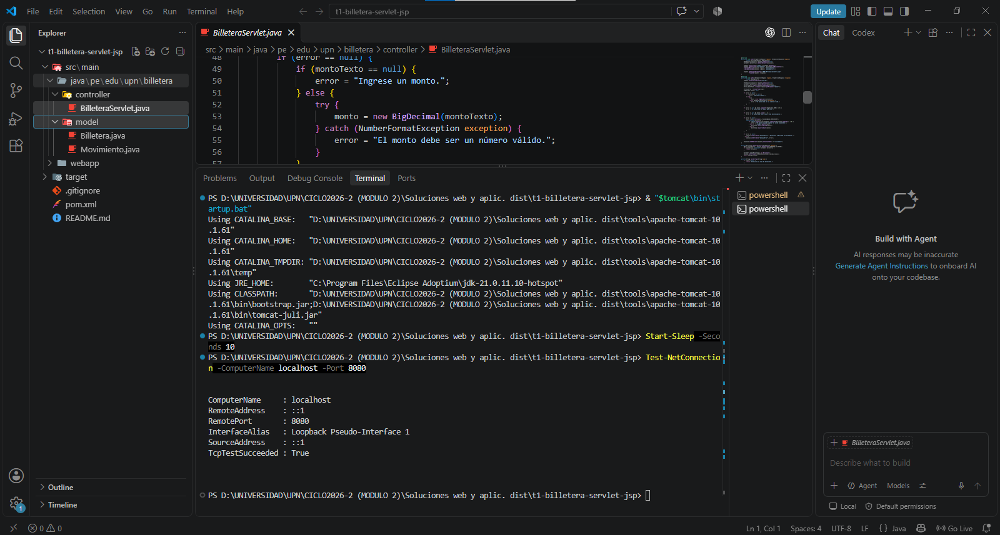
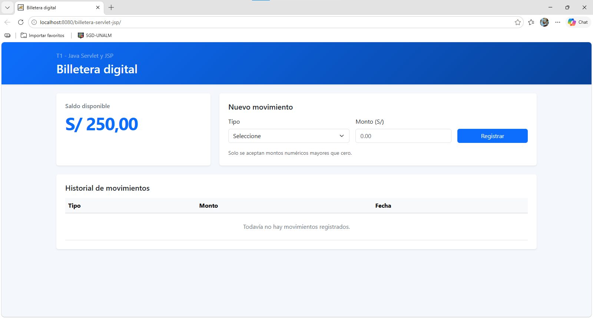
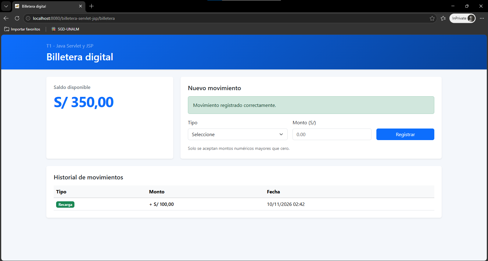
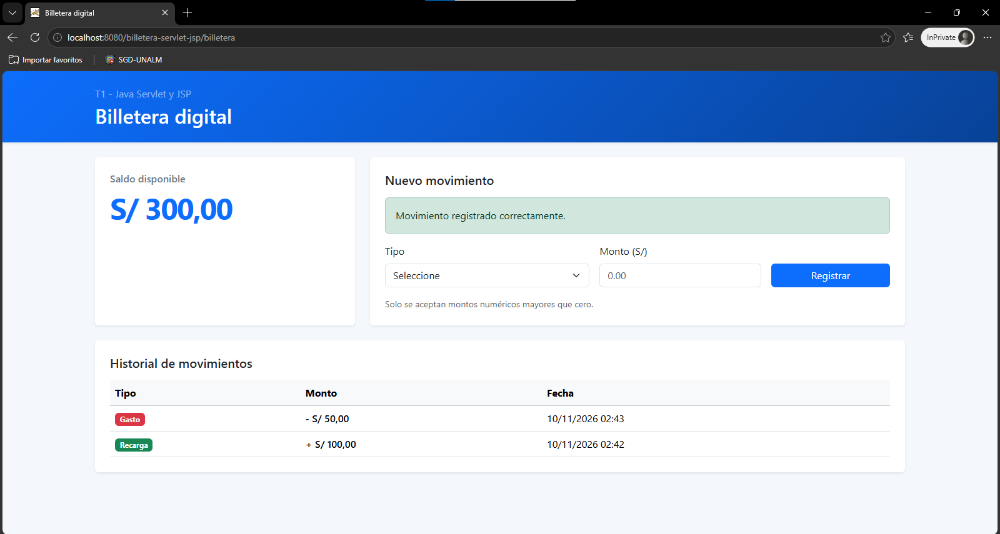
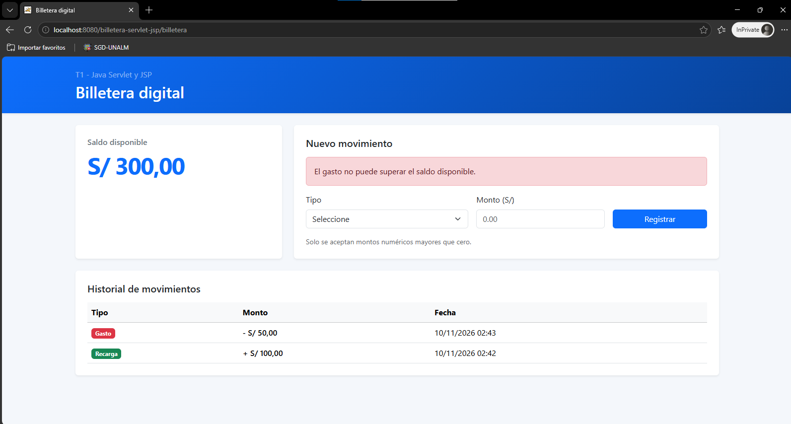
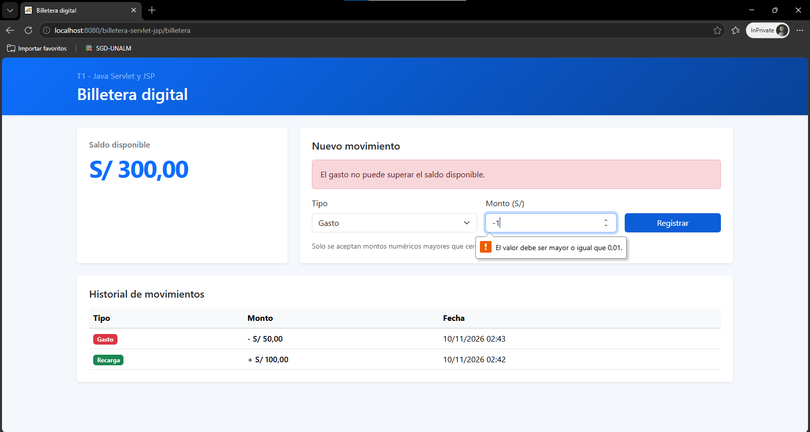

# Billetera digital - Java Servlet y JSP

Aplicación web de billetera digital desarrollada con Java puro, Servlet, JSP, JSTL, `HttpSession` y Bootstrap. El estado se conserva únicamente durante la sesión del usuario.

## Tecnologías

- Java 21 LTS (verificado con Temurin 21.0.11)
- Jakarta Servlet 6.0
- JSP y JSTL 3
- Apache Tomcat 10.1 (verificado con 10.1.61)
- Maven 3.9 o superior (verificado con 3.10.0)
- Bootstrap 5.3

## Funcionalidades

- Saldo inicial de S/ 250.00.
- Registro de recargas y gastos.
- Historial ordenado del movimiento más reciente al más antiguo.
- Persistencia temporal mediante `HttpSession`.
- Validación en el Servlet antes de modificar el estado.
- Patrón Post/Redirect/Get para evitar duplicados al actualizar la página.

## Validaciones

La aplicación rechaza:

- campos vacíos;
- texto o valores no numéricos;
- cero y números negativos;
- montos con más de dos decimales;
- gastos mayores que el saldo disponible;
- tipos de movimiento inexistentes.

Un movimiento inválido no modifica el saldo ni el historial.

## Ejecución

1. Instalar Java 21, Maven 3.9 o superior y Tomcat 10.1.
2. Generar el archivo WAR:

   ```bash
   mvn clean package
   ```

3. Copiar `target/billetera-servlet-jsp.war` en la carpeta `webapps` de Tomcat.
4. Iniciar Tomcat.
5. Abrir `http://localhost:8080/billetera-servlet-jsp/`.

## Casos mínimos de comprobación

| Caso | Resultado esperado |
| --- | --- |
| Abrir la aplicación | Saldo S/ 250.00 e historial vacío |
| Recargar S/ 100.00 | Saldo S/ 350.00 y recarga al inicio del historial |
| Gastar S/ 50.00 | Saldo S/ 300.00 y gasto al inicio del historial |
| Gastar S/ 400.00 | Operación rechazada; saldo permanece en S/ 300.00 |
| Enviar vacío, `A`, `0` o `-1` | Operación rechazada sin cambios |

## Evidencias de ejecución

### Tomcat activo en el puerto 8080



### Estado inicial de la billetera

La aplicación inicia con un saldo de S/ 250.00 y el historial vacío.



### Recarga de S/ 100.00

La recarga incrementa el saldo de S/ 250.00 a S/ 350.00 y aparece en el
historial.



### Gasto de S/ 50.00

El gasto reduce el saldo a S/ 300.00 y se muestra antes de la recarga por ser
el movimiento más reciente.



### Rechazo del gasto de S/ 400.00

El gasto supera el saldo disponible. La aplicación lo rechaza, conserva el
saldo de S/ 300.00 y mantiene solamente los dos movimientos válidos.



### Rechazo de un monto negativo

El control del formulario impide registrar `-1`; el saldo y el historial
permanecen sin cambios.



## Estructura principal

```text
src/main/java/pe/edu/upn/billetera/
|-- controller/BilleteraServlet.java
`-- model/
    |-- Billetera.java
    `-- Movimiento.java

src/main/webapp/WEB-INF/
|-- views/billetera.jsp
`-- web.xml
```

## Restricciones del proyecto

- No utiliza base de datos.
- No incluye autenticación.
- No consume API externas.
- No utiliza frameworks Java.
- El saldo y el historial se reinician cuando finaliza la sesión.
